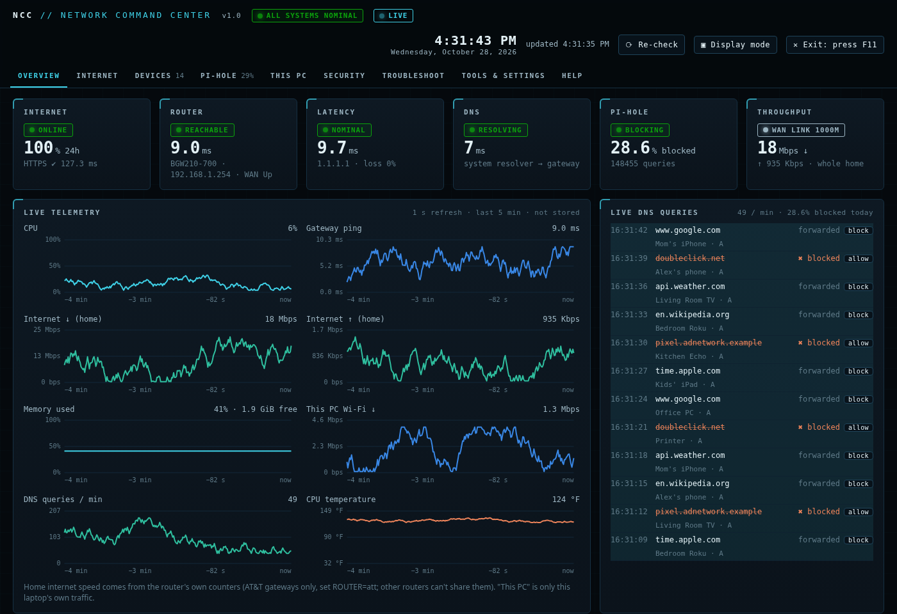
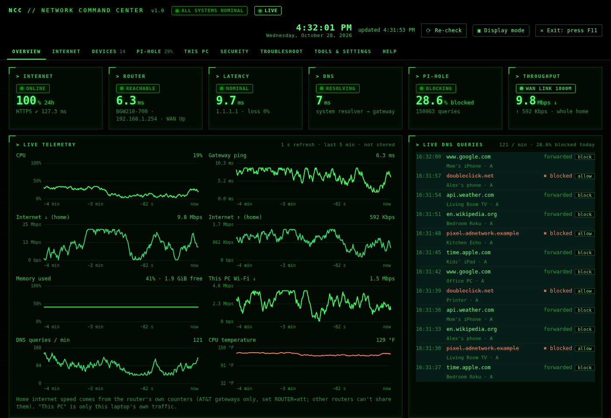
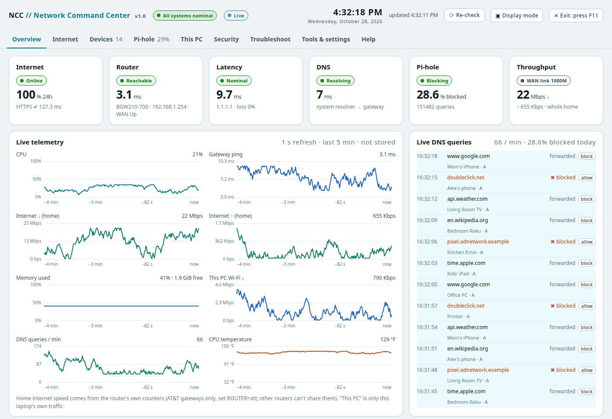

# NCC // Network Command Center

A home network dashboard that runs on any computer or Raspberry Pi. It shows you at a glance whether the
internet is working, how fast it is, which devices are on your Wi-Fi, how many ads were blocked, and how the computer
itself is doing. It sends phone alerts when something breaks.

- **Internet health:** up/down, latency, packet loss, outage history, a speed test on a schedule
- **Devices:** everything on your network, with names you choose, and a "new device joined" alert
- **Ad blocking** (optional): Pi-hole or AdGuard Home, with live stats, allow/block lists and per-device blocking
- **Phone access** (optional): open it on your phone from anywhere with Tailscale (free), no router changes
- **Alerts:** phone notifications (ntfy) and email (Gmail), a weekly report
- **Remote desktop** (optional): control the computer from another one
- **Three looks:** Sci-fi, Hacker or Clean, plus light/dark and accent colors
- **Light:** about 50-100 MB of memory, plain Python with no extra libraries

## Looks

Pick one when you install, and change it any time in **Tools & settings**. Each also has light/dark and accent colors.
(These pictures use made-up example data.)

| Sci-fi | Hacker | Clean |
|---|---|---|
| [](docs/screenshots/look-scifi.png) | [](docs/screenshots/look-hacker.png) | [](docs/screenshots/look-clean.png) |
| Dark command center with glowing accents | Black and green terminal | Light, simple and friendly |

## Which computers it runs on

| System | Ad blocker | Notes |
|---|---|---|
| **Linux**: Ubuntu, Debian, Linux Mint, Pop!_OS, Zorin, Raspberry Pi OS and other Debian-based versions | Pi-hole or AdGuard Home | The most complete version. Fedora, Arch and openSUSE aren't supported by the installer yet. |
| **Windows 10 (1809 or newer) and 11** | AdGuard Home | Pi-hole needs Linux. CPU temperature isn't shown. |
| **Mac** | | On the way. |

The computer should stay on and connected (a laptop, a desktop or a Raspberry Pi all work).

## Install on Windows

1. On this page click the green **Code** button, then **Download ZIP**.
2. Right-click the ZIP → **Properties** → tick **Unblock** (if you see it) → **OK**. Then right-click → **Extract All**,
   and put the folder somewhere it can stay, like `Documents\network-command-center`.
3. Open the folder and double-click **`install-windows.cmd`**. If Windows shows "Windows protected your PC", click
   **More info → Run anyway**.
4. Pick a pack (the same choices as on Linux, with AdGuard Home as the ad blocker). The installer shows the full plan and
   asks **"Go ahead?"** before it changes anything. If a step needs administrator rights (the ad blocker, Tailscale or
   Remote Desktop), Windows asks **once**: click **Yes**.

If you don't have Python, the installer adds it for you (Python 3.12 from python.org, through Windows' own `winget`).
The dashboard starts by itself whenever you sign in to Windows, and **Network Command Center** appears in the Start
menu. Everyday commands: open the folder in a terminal and type `.\ncc status`, `.\ncc restart`, `.\ncc logs` or
`.\ncc backup`. To remove it, double-click **`uninstall-windows.cmd`**.

Good to know on Windows:
- **AT&T gateways:** AdGuard Home can't hand out addresses on Windows, so set the DNS on each device instead (the
  dashboard shows how). For the whole home at once on AT&T, use a Raspberry Pi or Linux computer with Pi-hole.
- **Remote Desktop** only works on Windows Pro, Education and Enterprise. You sign in with your normal Windows account.
- **Wi-Fi neighbors** on Windows 11 need Location turned on (Settings → Privacy & security → Location).
- The dashboard runs while you're signed in. The ad blocker runs all the time.

## Install on Linux

1. Open a terminal and download it:
   ```
   git clone https://github.com/ollietech02/network-command-center.git
   cd network-command-center
   ```
   No git? On this page click the green **Code** button, then **Download ZIP**, and unzip it.
2. Run the installer as your normal user (it asks for your password when it needs it):
   ```
   ./install/install.sh
   ```
3. Pick a pack:

| Pack | What you get | Questions |
|---|---|---|
| **1. Dashboard only** | Just the dashboard | None |
| **2. Home Shield** | Dashboard + Pi-hole ad blocker | None |
| **3. Everything** | Dashboard + Pi-hole + Tailscale (phone access) + remote desktop + restart buttons | Only the Tailscale sign-in |
| **4. Custom** | You choose: look, ad blocker (Pi-hole / AdGuard Home / none), Tailscale, remote desktop, restart buttons | A few |

Before changing anything, the installer shows the full plan and asks **"Go ahead?"**.

If you chose Tailscale, the installer shows a sign-in link. Open it, make a free account (sign in with Google,
Microsoft, Apple or GitHub), click **Connect**, and the installer carries on by itself.

No menu: `./install/install.sh --pack shield` (packs: `dashboard`, `shield`, `everything`). Add `--yes` to accept
every default.

**Remote desktop on Linux:** the installer picks the tool that suits your desktop. Your sign-in details go in
`remote-login.txt` in your home folder (only you can read it), and the dashboard's **Security** tab shows how to
connect. It's reachable from your home network and Tailscale, never the open internet.

| Your computer | What the installer turns on | How you connect |
|---|---|---|
| Ubuntu 24.04 or newer, Debian 13 with GNOME | GNOME's built-in **Remote Login** | Any RDP app (Windows "Remote Desktop Connection", the Windows App, Remmina). You start at the login screen. |
| **Raspberry Pi OS** with desktop | Its built-in **VNC** screen sharing | A VNC app such as RealVNC Viewer (free). You see the Pi's screen as it is. |
| Debian 12, Linux Mint, or Xfce, MATE, KDE desktops | **xrdp**, from your system's own packages | Any RDP app. It opens its own desktop session, so sign out at the computer first. |
| No desktop (servers, Raspberry Pi OS **Lite**) | Nothing: there's no screen to show | |

## After installing

- Open **http://localhost:8088**, or **Network Command Center** in your apps menu.
- **Make the ad blocker cover your whole home:** open the dashboard's **Pi-hole** (or **AdGuard Home**) tab.
  The **Whole-home setup** guide shows the steps for your router, with your own addresses filled in, and counts how
  many devices are using the ad blocker so you can tell when it's working. The short version is below.
- **Phone alerts and email:** set them up in the dashboard's **Security** tab.
- **Change the look:** **Tools & settings → Appearance → Style**. Each browser can pick its own.
- **Using the computer yourself for a while?** Press **⏸ Pause** at the top of the dashboard (on the computer itself).
  Public web access and automatic speed tests switch off for 30 minutes to 4 hours (or until you press **Resume**) and
  come back by themselves. Monitoring, the ad blocker and alerts keep running.
- **Something wrong?** See [Found a bug?](#found-a-bug) below.

## Whole-home ad blocking

Until devices are pointed at the ad blocker, it only protects the computer it's installed on. The installer never
changes your router, so you do this part yourself (about 5 minutes):

**Most routers** (Google/Nest Wifi, eero, TP-Link, ASUS, Netgear, Linksys and others):
1. Give this computer an address that never changes: a "DHCP reservation" in the router, or a manual address in
   Settings → Wi-Fi → ⚙ → IPv4.
2. In the router's settings, find **DNS** (usually under LAN, DHCP or Advanced) and set **DNS 1** to this computer's
   address. Leave DNS 2 empty.
3. Turn Wi-Fi off and on on each device.

**AT&T gateways (BGW210, BGW320) and others that hide the DNS setting:** the ad blocker hands out the addresses instead.
1. Give this computer a manual address outside AT&T's range, e.g. `192.168.1.2` (Settings → Wi-Fi → ⚙ → IPv4 → Manual:
   netmask `255.255.255.0`, gateway `192.168.1.254`, DNS `1.1.1.1`). Then run `./ncc restart`.
2. In Pi-hole (`http://localhost:8081/admin` → Settings → DHCP) turn on the DHCP server: range `192.168.1.64` to
   `192.168.1.253`, router `192.168.1.254`, lease time `7d`. In AdGuard Home it's Settings → DHCP settings.
3. **Right after**, on the gateway (`http://192.168.1.254` → Home Network → Subnets & DHCP) set **DHCPv4 Server** to
   **Off**. It asks for the Device Access Code on the gateway's sticker.
4. Turn Wi-Fi off and on on each device.

While the computer is off, new devices can't join, and after 7 days the rest lose their connection, so keep it plugged
in. **To undo:** turn the gateway's DHCPv4 Server back on, then turn off the ad blocker's DHCP. If a few devices still
show ads, they may be using AT&T's DNS over IPv6: Home Network → IPv6 → Off.

**One device only:** set that device's DNS to this computer's address (iPhone: Settings → Wi-Fi → ⓘ → Configure DNS →
Manual; Windows: Settings → Network → your network → DNS server assignment → Edit).

## Safe by default

- The dashboard only listens on the computer itself (`localhost`), so other devices can't open it directly. Phones reach it through Tailscale's private
  network, never through an open port.
- Nothing is opened to the internet. "Web access" (any browser, no Tailscale) is a separate switch you turn on
  yourself, and it uses passwords plus emailed sign-in codes.
- It never signs in to your router or changes its settings, firewall or Wi-Fi. On Windows it adds Windows Firewall
  rules only for what you picked (ad blocker, Remote Desktop), limited to your home network and Tailscale.
- Passwords live in `~/.config/ncc/secrets.env` (Windows: `C:\Users\<you>\.config\ncc\secrets.env`), readable only by you, and
  never in this folder.
- Pi-hole, AdGuard Home and Tailscale are downloaded only from their official sources. AdGuard Home is checked against
  its published checksum; on Windows, Tailscale's installer must carry Tailscale's digital signature. If the ad blocker breaks name lookups, the installer undoes its DNS change.

## Everyday commands (Linux)

```
./ncc status      is it running?
./ncc restart     restart the dashboard
./ncc logs        recent log lines
./ncc backup      back up settings and history (keep the file private: it holds passwords)
./ncc test        quick self-test
```

## Uninstall (Linux)

```
./install/uninstall.sh
```

It removes the dashboard and asks separately about Pi-hole, AdGuard Home, Tailscale, remote desktop, and your history.

## AT&T gateways

On AT&T gateways (BGW210 / BGW320), the installer notices and turns on extra router stats read from the gateway's own
status pages: whole-home internet speed, data usage, and the device list. Other routers get everything else.

## Settings file

`config/ncc.env` holds the settings; `config/ncc.env.example` explains each one. After changing it, run `./ncc restart`.

## Get help from your own AI

Bring whichever AI assistant you already use. Nobody shares an account, and you never need one from this project.

- **Any AI (even a chat app on your phone):** in the dashboard, **Troubleshoot → Copy for my AI**. It copies a health
  report with passwords and private details removed, plus instructions. Paste it into Claude, ChatGPT, Gemini, Copilot
  or any other assistant and describe the problem.
- **AI coding tools that can work on your computer** (Claude Code, Codex, Gemini CLI, Cursor, GitHub Copilot and others):
  open the tool in the dashboard folder and describe the problem, for example *"the dashboard says DNS is failing, help
  me fix it"*. They automatically read [`AGENTS.md`](AGENTS.md), which explains how everything works, the commands to
  use, and the safety rules (look first, ask before changing anything, never show passwords). The health report on its
  own: `./ncc doctor` (Windows: `ncc doctor`).
- **The "Ask" box in the Troubleshoot tab:** pick your assistant in **Tools & settings → AI assistant** (Claude Code,
  Codex or Gemini CLI). It uses that program on this computer with your own sign-in, sends it only a snapshot of the
  measurements with private details removed, and only answers questions asked on this computer.

## Found a bug?

Please tell us! Open the **[Issues](https://github.com/ollietech02/network-command-center/issues)** page and click
**New issue → Report a problem** (a free GitHub account is needed). The dashboard has a shortcut too:
**Troubleshoot → Found a bug? → Report a problem**, which fills in your version for you. Ideas are welcome there as well
(**Suggest an idea**).

Reports are public, so leave out passwords, email addresses and other private details. Have a look at the open issues
first: someone may have reported it already.

## Credits

Pi-hole, AdGuard Home and Tailscale are separate projects owned by their makers. This dashboard just installs and
talks to them. Licensed under the MIT License (see `LICENSE`).
